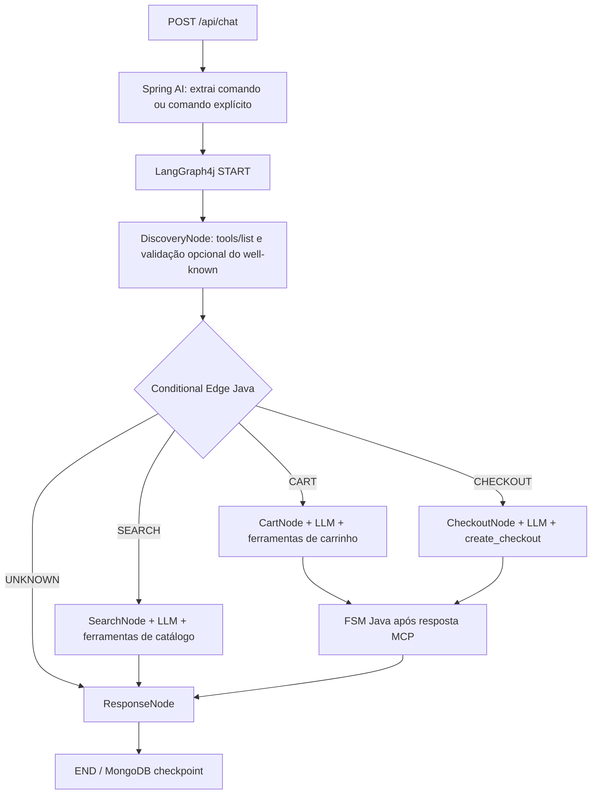

# Shopify Commerce — MCP Client único + FSM + LangGraph4j

Starter de estudos em **Java 25 / Spring Boot 4.0.2 / Spring AI 2.0.1 / LangGraph4j 1.9.6 / MongoDB**. Inclui **um único MCP Client** apontando para um UCP Server (a Shopify ou o mock de desenvolvimento). Não há `SupervisorNode`, registro por lojista, nem implementações locais das tools reais.

> **Escopo:** busca no catálogo, carrinho e **preparação** do checkout. `complete_checkout`, pagamentos e operações destrutivas não são disponibilizados à LLM. A integração de autenticação do Checkout MCP da Shopify **não está implementada**; use o mock para testar esse passo, ou configure seu transporte autenticado antes de testar na Shopify real.

## Arquitetura



- `SyncMcpToolCallbackProvider`: converte as ferramentas reais do `tools/list` em `ToolCallback` (não existe `@Tool` espelhando a API da Shopify).
- `McpToolCatalog`: filtra as callbacks de **um único servidor**, por domínio.
- `GuardedMcpTool`: **decorador** do callback remoto, acrescenta `meta["ucp-agent"].profile`, valida argumentos, restringe ferramentas e registra resultados MCP; **não recria a tool no backend**.
- `CommerceStateMachine`: estados do carrinho/checkout mudam somente após resposta MCP estruturada validada (veja limitações de confirmação em produção abaixo).
- `CommerceGraphConfiguration`: aresta condicional Java, sem agente supervisor.
- `MongoDBSaver`: mantém checkpoints por `threadId`/`conversationId`.

**Trade-off:** o roteamento e as transições da FSM são determinísticos. A seleção de tools e a formulação dos argumentos **dentro do agente** continuam probabilísticas e, por isso, são validadas no backend.

## Pré-requisitos

- Docker e Docker Compose, ou Java 25 + Maven 3.9+.
- `OPENAI_API_KEY` para executar os nós LLM (inclusive usando comando estruturado).
- Um UCP Server MCP com Streamable HTTP. Para desenvolvimento, o mock opcional já acompanha o projeto.

## Teste local com apenas um UCP Server simulado

### Rodando Spring Boot localmente

```bash
# Na pasta do projeto
docker compose --profile demo up -d mongo mock-ucp
export OPENAI_API_KEY='sua-chave'
mvn test
mvn spring-boot:run
```

- MongoDB: `localhost:27017`.
- UCP mock: `http://localhost:8090/api/ucp/mcp`.
- App: `http://localhost:8080/api/chat`.
- `Mock UCP` é um servidor remoto separado, implementado em `mock-ucp/server.py` apenas para exercitar o **cliente MCP real**. O aplicativo Java **não cria nenhuma ferramenta de comércio**.

### Rodando a aplicação inteira no Docker

```bash
export OPENAI_API_KEY='sua-chave'
docker compose --profile app up --build
```

O profile `app` sobe `mongo`, `mock-ucp` e a aplicação. No Docker, a URL da conexão MCP será `http://mock-ucp:8090`.

## Chamando a API

Use sempre o mesmo `conversationId` para continuar o estado persistido:

```bash
curl -X POST http://localhost:8080/api/chat \
  -H 'Content-Type: application/json' \
  -d '{"conversationId":"teste-1","command":"SEARCH","query":"tênis","message":"Encontre tênis"}'
```

Depois escolha o segundo resultado da busca:

```bash
curl -X POST http://localhost:8080/api/chat \
  -H 'Content-Type: application/json' \
  -d '{"conversationId":"teste-1","command":"ADD_TO_CART","productReference":"2","quantity":1,"message":"Adicione o segundo ao carrinho"}'
```

```bash
curl -X POST http://localhost:8080/api/chat \
  -H 'Content-Type: application/json' \
  -d '{"conversationId":"teste-1","command":"VIEW_CART"}'
```

```bash
curl -X POST http://localhost:8080/api/chat \
  -H 'Content-Type: application/json' \
  -d '{"conversationId":"teste-1","command":"CREATE_CHECKOUT"}'
```

Há requisições adicionais em `examples/requests.http`. Se omitir `command`, o `SpringAiIntentExtractor` usará Spring AI para converter a mensagem para um comando estruturado; ele **não modifica estados comerciais**. Para testar extração por regras simples, use `--spring.profiles.active=rules` (os agentes continuam chamando a LLM).

## Conectar a uma única loja Shopify

```bash
export OPENAI_API_KEY='sua-chave'
export SHOPIFY_MERCHANT_ORIGIN='https://sua-loja.myshopify.com'
export UCP_SERVER_BASE_URL='https://sua-loja.myshopify.com'
export UCP_MCP_PATH='/api/ucp/mcp'
export UCP_AGENT_PROFILE_URL='https://seu-agente.example/.well-known/ucp'
export UCP_VERIFY_WELL_KNOWN=true
mvn spring-boot:run
```

**Atenção:** o MCP Client é inicializado pelo Spring AI na subida da aplicação a partir de `UCP_SERVER_BASE_URL` e `UCP_MCP_PATH`. A etapa `DiscoveryNode` confere `tools/list` e, quando habilitado, **valida** se `/.well-known/ucp` publica a mesma URL. Ela não reconfigura um cliente conectado dinamicamente depois da inicialização.

- A Shopify exige um UCP Agent Profile válido (`meta["ucp-agent"].profile`). Um URL fictício não basta em produção.
- **Checkout MCP exige Bearer token ou assinatura HTTP** (e pode exigir header `Shopify-Buyer-IP` nas requisições de bearer). Adapte o transporte Spring MCP para incluir autenticação segura **antes** de habilitar `CREATE_CHECKOUT` na Shopify real. O projeto não promete suportar checkout real sem essa etapa.
- `update_cart` tem **semântica de substituição completa**. O código exige `get_cart` no mesmo turno, preserva os outros itens e verifica campos de contexto antes de aceitar `update_cart`; valide também regras específicas da sua loja.
- O callback MCP do Spring AI 2.0.1 pode expor ao consumidor só `content` e não `structuredContent`/`isError` completos. `UcpPayloads` analisa o texto JSON de resposta e detecta erros estruturados comuns, mas **essa implementação não substitui a confirmação transacional e reconciliação direta com a Shopify**. Antes de produção, utilize `McpSyncClient.callTool` para conferir `isError` e `structuredContent` originais e reconcilie operações por idempotency keys.
- Os produtos provenientes da busca podem não expor diretamente uma variante. `ProductChoice` recusa adicionar produto sem `ProductVariant` conhecido. Use `get_product` para detalhamento.
- Não armazene credenciais ou dados de cartão no estado. Não execute pagamento automaticamente.

## Testes e estrutura

```text
src/main/java/com/example/commerce/
  api/       ChatController, ChatService, DTOs
  config/    CommerceGraphConfiguration (MongoDB + arestas condicionais)
  domain/    CommerceStateMachine, status enums, ProductChoice
  graph/     CommerceState, DiscoveryNode, SearchNode, CartNode, CheckoutNode, ResponseNode
  intent/    SpringAiIntentExtractor (opcional parser de regras)
  mcp/       McpToolCatalog, ScopedTools, GuardedMcpTool, InvocationLog, UcpPayloads
mock-ucp/    Servidor MCP HTTP fake para testes com a LLM
```

Testes JUnit: FSM, resolução de produtos, parser MCP, proteção dos callbacks e verificação do meta UCP.

**Limitações de produção:** autenticação do endpoint REST, isolamento de conversas por usuário, idempotência durável nas mutações, locks distribuídos por thread, retomada após crash entre chamada MCP e checkpoint, limites de taxa, resposta e ações, gestão de permissões e tratamento de dados privados. A implementação de exemplo utiliza lock local por conversa e não resolve múltiplas instâncias.

## Referências

- [Spring AI MCP Client](https://docs.spring.io/spring-ai/reference/api/mcp/mcp-client-boot-starter-docs.html)
- [Spring AI Tool Calling](https://docs.spring.io/spring-ai/reference/api/tools.html)
- [LangGraph4j MongoDB Saver](https://langgraph4j.github.io/langgraph4j/main/core/mongodb-saver/)
- [Shopify Cart MCP](https://shopify.dev/docs/agents/carts-and-checkout/cart-mcp)
- [Shopify Checkout MCP](https://shopify.dev/docs/agents/carts-and-checkout/checkout-mcp)

## Status de validação

Este starter foi inspecionado estruturalmente e o servidor mock foi submetido a testes HTTP/JSON-RPC locais. **O `mvn test` e o build Java 25 não foram executados neste ambiente** (há JDK 21, sem Maven). Execute-os na sua máquina ou Docker; o código deve ser tratado como base de estudo/teste, e não integração Shopify homologada.
