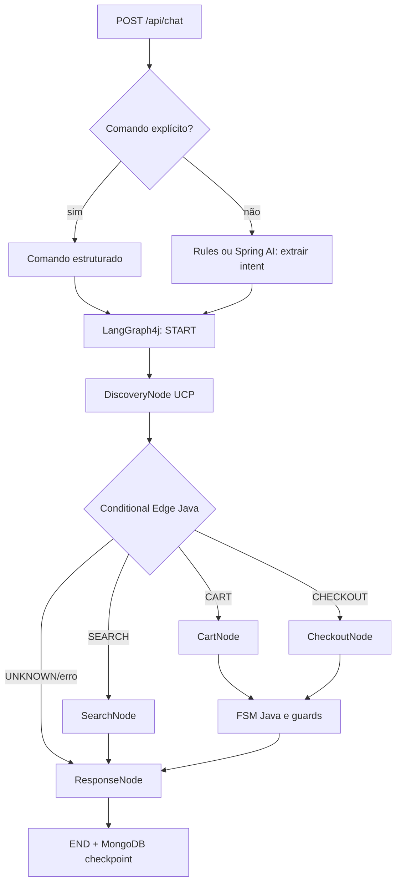

# Shopify Commerce FSM — Spring Boot 4 / Java 25 / Spring AI / LangGraph4j / MongoDB

Projeto de estudo: chatbot de comércio conversacional **sem SupervisorNode**, com roteamento controlado por enums e **FSM 100% Java**. A interpretação da frase do usuário pode usar Spring AI, mas **a IA nunca define `cartStatus` nem `checkoutStatus`**. O backend só altera estado após sucesso da operação da loja.

> **Escopo deste starter:** busca do catálogo, adicionar/remover itens, consultar carrinho e **criar checkout com URL para revisão do comprador**. Não executa `complete_checkout`, captura de cartão, aprovação automática, reembolso ou pagamento.

## Arquitetura



### Responsabilidades

| Componente | Função |
|---|---|
| `IntentExtractor` | Extrai `CommerceCommand`, query, número da variante; não modifica estado |
| `CommerceStateMachine` | Guardas de checkout, estado do carrinho e invalidação de checkout depois de alteração |
| `CommerceGraphConfiguration` | Aresta condicional pura, **sem LLM supervisor** |
| `CommerceState` | Contexto persistido por thread no MongoDB Saver |
| `DiscoveryNode` | Lê o well-known UCP (modo real) e retorna endpoint MCP e descobre as tools com `tools/list` |
| `SearchNode` | Somente catálogo (`search_catalog`) |
| `CartNode` | Somente carrinho (`create_cart`, `get_cart`, `update_cart`) |
| `CheckoutNode` | **Somente** `create_checkout` |
| `UcpGateway` | Port com `MockUcpGateway` e `ShopifyUcpGateway` |

## Pré-requisitos

- **Java 25** e **Maven 3.9+** (ou Docker para compilar com Java 25).
- **Docker Compose** para subir MongoDB.
- Opcional: chave OpenAI, uma loja Shopify com UCP e credenciais de checkout para os modos reais.

## Executar demo offline (sem OpenAI e sem Shopify)

```bash
docker compose up -d mongo
mvn test
mvn spring-boot:run
```

Alternativa sem instalar Java/Maven localmente:

```bash
docker compose --profile app up --build
```

API: `http://localhost:8080/api/chat` e healthcheck `http://localhost:8080/actuator/health`.

### 1. Busca

```bash
curl -s http://localhost:8080/api/chat \
  -H 'Content-Type: application/json' \
  -d '{"conversationId":"demo-1","command":"SEARCH","query":"tênis"}'
```

### 2. Adicionar o segundo resultado

```bash
curl -s http://localhost:8080/api/chat \
  -H 'Content-Type: application/json' \
  -d '{"conversationId":"demo-1","command":"ADD_TO_CART","productReference":"2","quantity":1}'
```

### 3. Consultar carrinho

```bash
curl -s http://localhost:8080/api/chat \
  -H 'Content-Type: application/json' \
  -d '{"conversationId":"demo-1","command":"VIEW_CART"}'
```

### 4. Preparar checkout (NÃO finaliza pagamento)

```bash
curl -s http://localhost:8080/api/chat \
  -H 'Content-Type: application/json' \
  -d '{"conversationId":"demo-1","command":"CREATE_CHECKOUT"}'
```

### 5. Mensagem natural em modo rules

```bash
curl -s http://localhost:8080/api/chat \
  -H 'Content-Type: application/json' \
  -d '{"conversationId":"demo-2","message":"Quero um tênis"}'
```

O parser `RuleIntentExtractor` é propositalmente simples (algumas frases em português); para **determinismo completo de ponta a ponta, envie `command` e parâmetros explícitos**. Para interpretar texto livre, ligue o perfil `ai`.

## Usar extração de intenção pelo Spring AI

```bash
export OPENAI_API_KEY='sua-chave'
SPRING_PROFILES_ACTIVE=ai mvn spring-boot:run
```

A configuração `spring.ai.model.chat=none` no perfil padrão permite rodar a demo sem precisar da chave. Em `ai`, o Spring AI chama o modelo via `ChatClient.entity(IntentData.class)`. A LLM pode errar a extração, então o backend **valida o comando e os guards**, e `UNKNOWN` não executa side effects.

## Usar uma loja Shopify UCP real

Configure as variáveis, sem as adicionar ao Git:

```bash
export COMMERCE_MODE=shopify
export SHOPIFY_MERCHANT_ORIGIN='https://SUA-LOJA.myshopify.com'
export UCP_AGENT_PROFILE_URL='https://URL-PUBLICA-DO-SEU-AGENT-PROFILE/.well-known/ucp'
export SHOPIFY_CHECKOUT_BEARER_TOKEN='token-de-checkout'   # Apenas para criar checkout
mvn spring-boot:run
```

- `DiscoveryNode`: consulta as tools por `tools/list` e requisita `https://loja/.well-known/ucp`, consulta `ucp.services["dev.ucp.shopping"][]`, seleciona `transport=mcp` e valida origem HTTPS.
- `ShopifyUcpGateway`: implementa **o binding JSON-RPC das tools Shopify UCP**, enviando `meta["ucp-agent"].profile` em todas as tools. Para uma única loja isso é mais enxuto do que um MCP client genérico.
- `search_catalog`: envia `catalog.query` e captura variante **somente** se a API retornar `ProductVariant` no resultado. Se não houver variante explícita, o backend pede seleção detalhada, não cria ID fictício.
- `create_cart` / `get_cart` / `update_cart`: manipula `cart.line_items`; **`update_cart` substitui o carrinho completo**, então o adapter recupera e preserva `context`, `buyer`, `attribution`, `signals` antes da atualização.
- `create_checkout`: exige bearer token externo, usa `checkout.cart_id`; devolve `continue_url` ao comprador. OAuth Client Credentials / HTTP Message Signatures são responsabilidades da camada de autenticação, **não implementadas** nesta versão.

**Importante:** Shopify pode publicar extensões, autenticação e schemas diferentes por merchant/capability. Valide `tools/list` e os schemas reais para a loja antes de habilitar em produção. Este é um adapter de exemplo, não um cliente MCP genérico completo nem implementação de negociação automática de toda a especificação UCP. Em particular, busca com produtos que não exponham a variante requer `get_product` e seleção explícita antes de adicionar ao carrinho (não implementado no starter).

**Segurança:** o merchant é configurado pelo operador, não recebido via payload arbitrário (evita SSRF). O endpoint MCP deve ter HTTPS e o mesmo hostname da loja. Para produção também imponha allowlist dos domínios de merchants, limites de chamadas/tamanho de resposta e limites de catálogo por tenant. Checkout exige sessão/autorização adequada do comprador; esta demo somente prepara um checkout. O profile `UCP_AGENT_PROFILE_URL` precisa ser uma URL pública válida com capacidades compatíveis.

## Observabilidade e MongoDB

Os checkpoints ficam em `commerce_graph.lg4j_thread` e `commerce_graph.lg4j_checkpoint` (prefixo padrão). `threadId=conversationId` recupera o estado entre requisições e `releaseThread(false)` preserva a thread ativa.

`CartStatus`: `EMPTY` ou `ACTIVE`. `CheckoutStatus`: `NONE`, `AWAITING_BUYER`, `COMPLETED` (o último é apenas modelado: nenhum pagamento é executado neste projeto). Alterar carrinho invalida checkout pendente.

**Atenção sobre o modo mock:** os carrinhos simulados ficam em memória. Checkpoints persistem no MongoDB, mas reiniciar a aplicação apaga os carrinhos mock. Em loja real, carrinhos existem na Shopify; para um mock durável, persista seu repositório separadamente.

## Próximas evoluções de produção

- Resolver variantes com `get_product`, `lookup_catalog`, validação de estoque e confirmação explícita quando seleção for ambígua.
- OAuth Client Credentials / assinaturas HTTP e expiração/rotação de tokens; perfil UCP próprio hospedado.
- Registro/idempotência por comando, locks **distribuídos** por `conversationId` e deduplicação no caso de retry após checkpoint.
- Autenticação do REST endpoint e vínculo `conversationId` ↔ usuário/tenant; nunca aceitar um ID de conversa não autorizado.
- Checkpoint TTL, resumo de mensagens, caching/TTL para discovery, rate limiting e sanitização de erros/logs.
- Webhook/polling para conciliação de checkout concluído, consentimento de pagamento e escalonamento ao storefront.
- Testes de integração com MongoDB/Testcontainers e ambiente sandbox de Shopify antes de habilitar em produção.

## Referências oficiais consultadas (outubro/2026)

- https://langgraph4j.github.io/langgraph4j/main/core/core-library/
- https://langgraph4j.github.io/langgraph4j/main/core/mongodb-saver/
- https://spring.io/blog/2026/06/12/spring-ai-2-0-0-GA-available-now/
- https://shopify.dev/docs/agents/catalog/storefront-catalog
- https://shopify.dev/docs/agents/carts-and-checkout/cart-mcp
- https://shopify.dev/docs/agents/carts-and-checkout/checkout-mcp

## Transparência da validação

Estrutura e arquivos gerados em 25/10/2026. As APIs foram conferidas na documentação, mas este ambiente não tem Maven, JDK 25 nem acesso à Maven Central para executar `mvn test`/`mvn package`. Execute os comandos de compilação e teste na sua máquina ou com Docker e ajuste eventuais diferenças de dependência antes de uso em produção.
